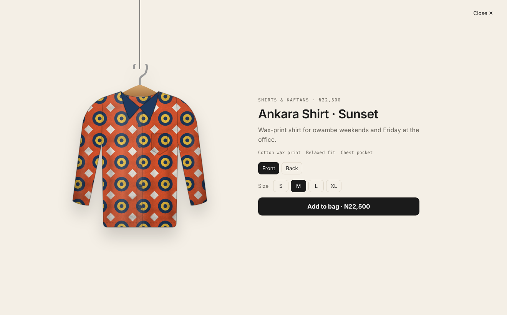
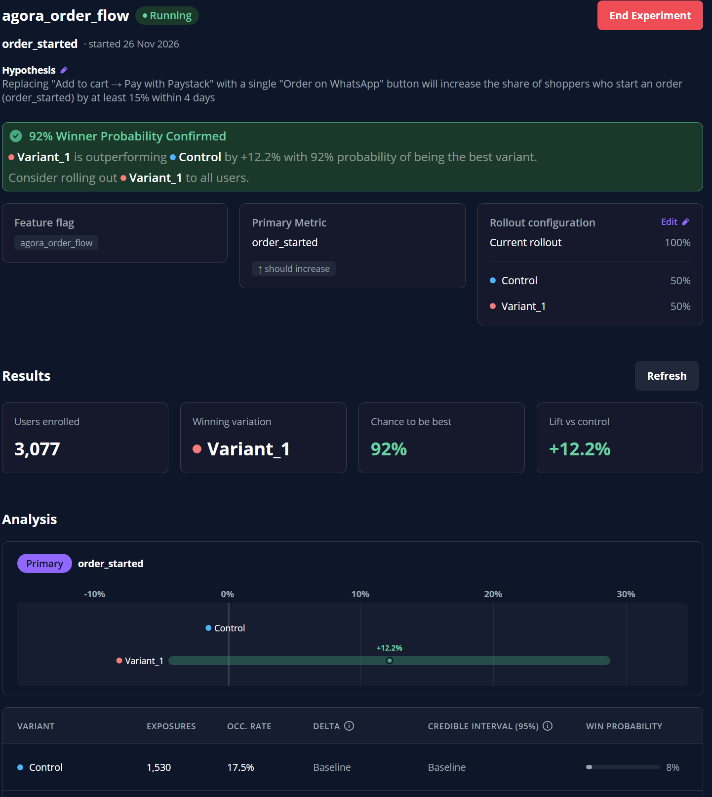
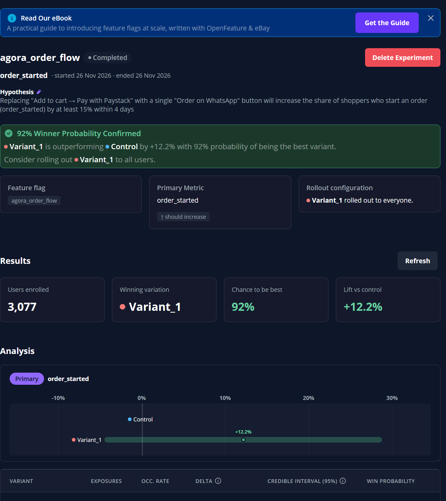

# Agora Market: WhatsApp vs cart, an A/B test with Flagsmith

Entry for **Toggle Wars: The Flagsmith Experimentation Hackathon** (WeMakeDevs), **Track 01: Test Something Real**.

**Live shop:** https://agora-market-sage.vercel.app · **Traffic lab:** https://agora-market-sage.vercel.app/lab


## The question

A small Nigerian online shop can take orders two ways: through a checkout cart on its website, or through a WhatsApp
chat with the seller. This project tests which one gets more shoppers to start an order, on one product page:

> **Hypothesis:** On a Nigerian product page, a single **Order on WhatsApp** button gets more shoppers to start an
> order than the usual **Add to bag → Checkout with Paystack** flow, because it takes fewer taps and lets
> shoppers talk to a person before paying.
>
> **Target set before the test:** at least 15% more shoppers starting an order, as written in the experiment in
> Flagsmith.

| | Control (`control`) | Variation (`whatsapp`) |
|---|---|---|
| Order flow | Add to bag → bag drawer → Checkout with Paystack → delivery details | Order on WhatsApp (opens a pre-filled chat for that piece and size) |
| Counts as an order started | Tap **Checkout with Paystack** in the bag | Tap **Order on WhatsApp** |

| Control: Add to bag | Variation: Order on WhatsApp |
|---|---|
|  |  |

Everything else is identical for both groups: the same 24-piece catalogue, the rail, the product views, prices and
delivery fee.

## The experiment setup

- **Flag:** `agora_order_flow`, multivariate. Flag value `control` = bag flow. The variation has the value `whatsapp`
  and shows in Flagsmith under its key, `Variant_1`
- **Metric:** `order_started`, occurrence, higher is better. It fires early in a visit, so it can be measured in a short test
- **Split:** 100% of shoppers enrolled, 50 / 50
- **Also tracked:** `add_to_cart` (control only). It is sent as an event but has no metric in Flagsmith yet, so it
  is not part of the results

## The shop

- **The rail:** all 24 pieces hang on a clothing rail. Hover to turn a piece to face you, drag a hanger sideways to
  move it along the rail (Shift + arrow keys on a keyboard), click to inspect it.
- **Inspect:** front and back views, size picker, and the order button for the shopper's variation.
- **Collection:** grid of every piece with category filters.
- **Bag and checkout (control only):** quantities, subtotal, delivery and total are computed from the bag. The
  delivery form stays in the browser and is not sent anywhere.
- The garments and the hero artwork are drawn in SVG for this project. The catalogue is a demo: no payments are
  taken and nothing is delivered, and the page says so.
- **Paystack is not integrated.** The "Checkout with Paystack" button stands in for a real checkout, so the control
  flow looks like a normal Nigerian store. Tapping it records the event and shows a demo confirmation.
- Dragging a hanger works with a mouse or the keyboard. On a touch screen you can scroll the rail and tap a piece.

## How Flagsmith is used

- `getExperimentFlag('agora_order_flow')` picks the order flow and records the **exposure** at the moment the flow is
  shown ([src/flagsmith.ts](src/flagsmith.ts))
- Each browser gets a stable identity (`shopper_<uuid>`), so exposures and conversions join per shopper
- `trackEvent('order_started')` fires on the conversion tap, then `flushEvents()` sends it before the shopper leaves
  (for WhatsApp the chat opens in a new tab)
- Flagsmith Experimentation's Bayesian engine reports lift and win probability, and the winner is rolled out with the
  same flag, with no redeploy

## Traffic

Two sources, kept honest:

1. **Real shoppers:** anyone who opens the live shop joins the Production experiment. Only these visits can answer
   the question for real.
2. **Traffic lab (`/lab`):** simulated shoppers, each a fresh Flagsmith identity, sent through the live experiment.
   The conversion rates are **assumptions set with sliders on the page**, so the lab proves the pipeline works end to
   end. It does not prove which flow is better. Lab traffic goes to the **Development** environment
   (`VITE_FLAGSMITH_SIM_ENV_KEY`), which runs the same flag, metric and experiment, so it never mixes with the real
   shoppers in **Production**.

## Results

Two experiments run on the same flag, one per Flagsmith environment, so simulated and real shoppers never mix.

### Development: simulated shoppers (the main result)

The hackathon allows simulated traffic for Track 01, so this is the result the entry is judged on. The traffic lab
sent 3,077 simulated shoppers through the experiment with these assumptions, set on the lab page:

- Bag flow: 35% add to bag, and 50% of those go on to checkout, so about 17.5% start an order
- WhatsApp flow: 20% tap Order on WhatsApp

| Flagsmith reported (26 Nov 2026) | |
|---|---|
| Users enrolled | 3,077 |
| Control (bag flow) | 1,530 exposures, 17.5% started an order |
| Leading variation | `Variant_1` (Order on WhatsApp) |
| Lift vs control | +12.2% |
| Chance to be best | 92% (control: 8%) |



**How to read it.** The WhatsApp button is ahead by 12.2%, with a 92% chance of being the better version. The
direction of the hypothesis held, but the lift is below the 15% target set before the test, so the hypothesis as
written was not met. The lead is strong, not certain: the 95% credible interval in the chart still starts a little below zero. The lab was
set so that WhatsApp really is about 14% better in relative terms, and Flagsmith's estimate landed close to that.
A gap of 17.5% vs 20% needs roughly 3,800 shoppers per variation to detect reliably (80% power, 5% significance);
this run stopped at about 1,540 per variation.

The simulation measures the assumptions typed into the lab. It shows the experiment working end to end. It does not
show what real shoppers prefer.

### Decision: ship the winner with the same flag

The experiment was ended in Development at 92%, and `Variant_1` was rolled out to everyone in that environment
from the Flagsmith dashboard. No code change and no redeploy: the shop reads the same flag, so every shopper in that
environment now gets the WhatsApp flow. Ending at 92% instead of waiting for 95% is a judgement call that a feature
flag makes cheap, because the same flag switches it back.



**Checked on the live site.** The traffic lab has a rollout check that asks Flagsmith what 20 brand-new shoppers
would get, without sending events. After the rollout it reported: "20 of 20 got whatsapp, 0 got control. 0 of 20
are in a running experiment." You can run it yourself at the bottom of the
[traffic lab](https://agora-market-sage.vercel.app/lab).

### Production: real shoppers (small test)

The live shop was opened in a few browsers to check the real path. Flagsmith enrolled 3 shoppers and both order
flows were served. That is far too few for a result, and Flagsmith shows the experiment as still collecting data.
Production keeps its 50 / 50 split: the rollout above was made in Development only.


### Limits

- Agora Market is a demo shop: no payment is taken, and a tap on an order button is not a purchase.
- Each browser counts as one shopper, so the same person on two devices is counted twice.
- The catalogue and prices are written for the demo.
- Events are sent from the browser with a public client-side key, as Flagsmith intends. Anyone could send fake
  events with it, so a real shop would also check orders on its server.
- The "Order on WhatsApp" button opens WhatsApp with the message filled in, but there is no real seller number.

## Run it locally

```bash
npm install
cp .env.example .env   # paste your client-side environment key
npm run dev
```

Without a key the page runs in preview mode and tracks nothing. Add `?variant=whatsapp` or `?variant=control` to the
URL to see each flow.

## Set up the experiment in Flagsmith

1. Create a project and an environment on [Flagsmith Cloud](https://app.flagsmith.com) and connect the managed
   warehouse for experiments.
2. Create the multivariate flag `agora_order_flow`, enabled, with value `control`, and add a variation with value
   `whatsapp`. Every variation needs a key (Flagsmith names it `Variant_1` by default): a variation without a
   key records no exposures.
3. Create the metric `order_started`: occurrence, direction up.
4. Create the experiment on `agora_order_flow` with the hypothesis above, 100% rollout, 50% to `whatsapp`, and
   `order_started` as the metric. Start it.
5. Put the environment's **client-side** key in `VITE_FLAGSMITH_ENV_KEY` (in `.env` locally, in the Vercel project
   settings when deployed).
6. For the traffic lab, repeat steps 1, 3 and 4 in a second environment and put its client-side key in
   `VITE_FLAGSMITH_SIM_ENV_KEY`.

## Stack

Vite, React and TypeScript, the `@flagsmith/flagsmith` JavaScript SDK (12.6), deployed on Vercel.

## Licence

MIT. See [LICENSE](LICENSE).
